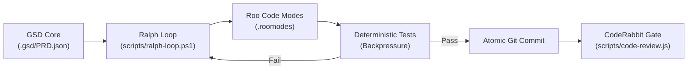

# SoundWave Autonomous AI Engineering Stack

This repository is configured with a unified **autonomous AI engineering lifecycle** combining **GSD Core**, **Roo Code**, **The Ralph Loop**, and **CodeRabbit**.

---

## Architecture Components



### 1. GSD Core (Spec-Driven Context Architecture)
- **Directory:** `.gsd/`
  - `PROJECT.md`: System architecture and core rules.
  - `ROADMAP.md`: High-level feature progression across phases.
  - `PRD.json`: Machine-readable backlog of tasks, acceptance criteria, and verification commands.
  - `STATE.md`: Real-time anti-context-rot ledger tracking active milestone and progress.

### 2. Roo Code (Multi-Persona Mode System)
- **Configuration:** `.roomodes`
  - `soundwave-architect`: Schema design, API contracts, streaming strategy.
  - `soundwave-coder`: Express.js backend implementation and route handlers.
  - `soundwave-tester`: API integration test suites and backpressure checks.
  - `soundwave-reviewer`: Automated security, leak, and quality reviews.

### 3. The Ralph Loop (Persistent Outer Execution Runner)
- **Scripts:**
  - `scripts/ralph-manager.js`: Cross-platform state manager (Node.js).
  - `scripts/ralph-loop.ps1`: Windows PowerShell outer loop.
  - `scripts/ralph-loop.sh`: Bash / macOS / Linux outer loop.

#### Ralph Commands:
```bash
# Check current progress and active task
node scripts/ralph-manager.js status

# Inspect next prompt context for the LLM
node scripts/ralph-manager.js next-prompt

# Run deterministic verification on active task
node scripts/ralph-manager.js verify

# Run single step of the loop (PowerShell)
powershell -ExecutionPolicy Bypass -File scripts/ralph-loop.ps1 -SingleStep

# Run continuous autonomous loop (PowerShell)
powershell -ExecutionPolicy Bypass -File scripts/ralph-loop.ps1
```

### 4. CodeRabbit Quality & Security Gate
- **Script:** `scripts/code-review.js`
  - Scans JavaScript and SQL files for SQL injections, unhandled promise rejections, audio stream pipe errors (`.on('error')`), and leaked credentials.
  - Exits with `0` on clean pass, non-zero on critical security violations.

```bash
# Run CodeRabbit review gate
node scripts/code-review.js
```
